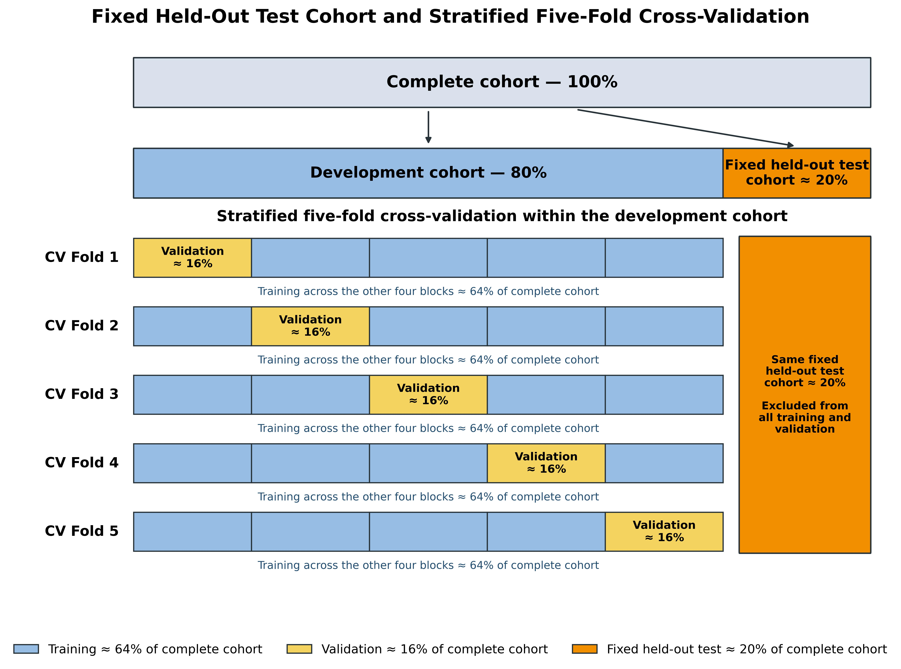
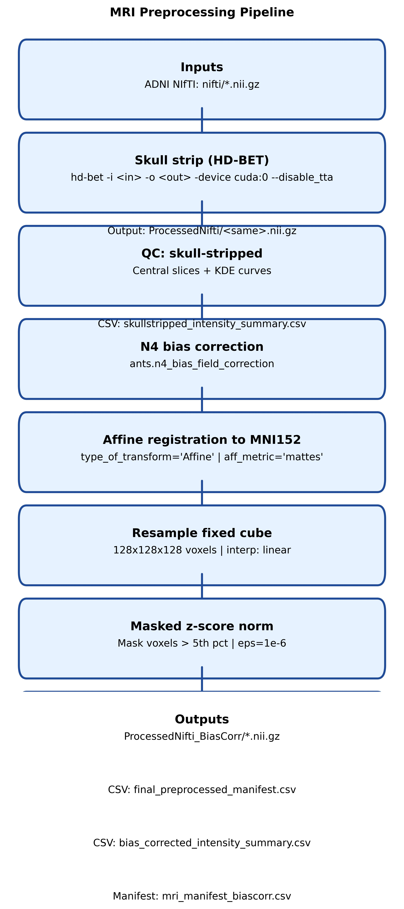

# Imbalance-Aware Six-Class Alzheimer's Disease Classification from 3D MRI

doi: [will be added later]

Code, analysis, and reproducibility materials accompanying a *Computers in Biology and Medicine* manuscript on imbalance-aware six-class classification of Alzheimer's disease stages from three-dimensional structural MRI.

> This repository supports research reproducibility. It is not a diagnostic system and is not intended for clinical use.

## 1. Project Overview

This project studies single-volume, six-class classification of T1-weighted brain MRI from the Alzheimer's Disease Neuroimaging Initiative (ADNI). The target classes are cognitively normal (CN), significant memory concern (SMC), early mild cognitive impairment (EMCI), mild cognitive impairment (MCI), late mild cognitive impairment (LMCI), and Alzheimer's disease (AD).

The main contribution is a task-specific integration of a parameter-compact 3D convolutional architecture with imbalance-aware optimization and sampling. Its individual components are established methods; the contribution lies in their combination and evaluation for this six-class MRI task.

The repository contains:

- The MRI preprocessing workflow.
- Persisted ImageID-level development and held-out test splits.
- The finalized proposed-model experiment.
- A scratch-trained 3D EfficientNet-B0 baseline.
- A no-sampler ablation of the proposed training pipeline.
- Paired statistical comparisons, supplementary confusion-matrix panels, and computational profiling outputs.

## 2. Study Scope

The experiments address a closed-set, six-class classification problem using one preprocessed 3D MRI volume as model input. All finalized models use the same class definitions, preprocessing sequence, persisted folds, and fixed held-out test set so that comparisons are aligned at the ImageID level.

The evaluation is designed to measure performance within this dataset and experimental protocol. It does not establish performance across institutions, scanners, acquisition protocols, or external cohorts.

## 3. Dataset

The study uses 3,592 MRI volumes obtained through ADNI. These are imaging records, not 3,592 unique participants.

| Class | MRI volumes |
|---|---:|
| AD | 405 |
| CN | 931 |
| EMCI | 1,091 |
| LMCI | 571 |
| MCI | 458 |
| SMC | 136 |
| **Total** | **3,592** |

The MRI data are not distributed in this repository. Researchers must independently obtain authorization and download eligible data through the [ADNI data-access process](https://adni.loni.usc.edu/data-samples/access-data/), then configure the path variables in the relevant notebooks for their local storage layout.

## 4. Evaluation Design

A fixed held-out test cohort of 719 MRI volumes (approximately 20% of the complete dataset) was separated from the final analyzed cohort of 3,592 volumes before cross-validation. The remaining 2,873 volumes (approximately 80%) form the development cohort. Stratified five-fold cross-validation within that development cohort gives, in each iteration:

- Approximately 64% of the complete cohort for training.
- Approximately 16% of the complete cohort for validation.
- The same 719-volume test cohort (approximately 20%), excluded from model fitting and checkpoint selection.

The CSVs in [`folds/`](folds/) are the frozen partitions used in the final experiments, not example or newly generated splits. The Proposed 3D CNN and 3D EfficientNet-B0 baseline were trained and evaluated using the same frozen data partitions stored in `folds/`, ensuring a directly paired same-data comparison. Inspection of the no-sampler notebook also confirms that it reads the corresponding train, validation, and test files from this shared fold root.

The actual directory structure is:

```text
folds/
├── fold_1/
│   ├── train.csv
│   ├── val.csv
│   └── test.csv
├── fold_2/
│   ├── train.csv
│   ├── val.csv
│   └── test.csv
├── fold_3/
│   ├── train.csv
│   ├── val.csv
│   └── test.csv
├── fold_4/
│   ├── train.csv
│   ├── val.csv
│   └── test.csv
└── fold_5/
    ├── train.csv
    ├── val.csv
    └── test.csv
```

### Frozen-split integrity audit

The committed CSVs were checked without modification. The observed partition and class counts are:

| Fold | Partition | Total | AD | CN | EMCI | LMCI | MCI | SMC |
|---:|---|---:|---:|---:|---:|---:|---:|---:|
| 1 | Train | 2,298 | 259 | 596 | 697 | 366 | 293 | 87 |
| 1 | Validation | 575 | 65 | 149 | 175 | 91 | 73 | 22 |
| 1 | Test | 719 | 81 | 186 | 219 | 114 | 92 | 27 |
| 2 | Train | 2,298 | 260 | 596 | 697 | 365 | 293 | 87 |
| 2 | Validation | 575 | 64 | 149 | 175 | 92 | 73 | 22 |
| 2 | Test | 719 | 81 | 186 | 219 | 114 | 92 | 27 |
| 3 | Train | 2,298 | 259 | 596 | 698 | 365 | 293 | 87 |
| 3 | Validation | 575 | 65 | 149 | 174 | 92 | 73 | 22 |
| 3 | Test | 719 | 81 | 186 | 219 | 114 | 92 | 27 |
| 4 | Train | 2,299 | 259 | 596 | 698 | 366 | 292 | 88 |
| 4 | Validation | 574 | 65 | 149 | 174 | 91 | 74 | 21 |
| 4 | Test | 719 | 81 | 186 | 219 | 114 | 92 | 27 |
| 5 | Train | 2,299 | 259 | 596 | 698 | 366 | 293 | 87 |
| 5 | Validation | 574 | 65 | 149 | 174 | 91 | 73 | 22 |
| 5 | Test | 719 | 81 | 186 | 219 | 114 | 92 | 27 |

All five test CSVs contain the same 719-ImageID set. Within every fold, the train and validation ImageID sets are disjoint, and neither overlaps the test set. Row counts equal unique-ImageID counts in every CSV.



*Fixed held-out test cohort and stratified five-fold evaluation design. Percentages for training and validation are expressed relative to the complete cohort.*

### Split unit and limitation

Splitting was performed at the ImageID/scan level. ImageIDs do not overlap among the training, validation, and held-out test partitions within a fold. Because ADNI can contain longitudinal scans from the same participant, participant-level grouping was not enforced; this should be considered when interpreting the reported internal-evaluation results.

## 5. MRI Preprocessing

The executable preprocessing workflow is documented in [`notebooks/Preprocessing.ipynb`](notebooks/Preprocessing.ipynb). The implemented sequence is:

1. Start from a raw T1-weighted NIfTI volume.
2. Perform brain extraction with HD-BET, with test-time augmentation disabled.
3. Apply N4 bias-field correction.
4. Perform affine registration to the MNI152 reference using ANTs.
5. Resample with linear interpolation to `128 × 128 × 128` voxels.
6. Apply foreground z-score normalization, where the foreground mask contains voxels above the volume's fifth-intensity percentile.
7. Save the resulting bias-corrected, registered, resampled NIfTI volume.



*Implemented MRI preprocessing sequence used to produce the model-ready NIfTI volumes.*

At model-loading time, each volume receives a separate deterministic input transformation: non-finite values are replaced, per-volume min-max normalization maps intensities to `[0, 1]`, and the array is converted to a tensor with shape `1 × 128 × 128 × 128`.

## 6. Proposed Model

The finalized proposed experiment is in [`notebooks/stage1_v2.ipynb`](notebooks/stage1_v2.ipynb). The network is trained from scratch and contains 2,643,626 total parameters.

At a high level, the architecture combines:

- Multiscale 3D feature extraction.
- Residual connections.
- Depthwise 3D convolutions.
- Squeeze-and-excitation channel attention.
- Stochastic depth regularization.
- Concatenated global average and global maximum pooling.
- A six-output classification head.

The model is parameter-compact, particularly relative to the baseline used here. This description concerns parameter count only: computational cost is also determined by operation count, activation memory, hardware, and implementation, so the model should not be interpreted as categorically lighter in every runtime measure.

## 7. Imbalance-Aware Training

The proposed pipeline combines the following components:

- Balanced per-class loss weights computed from each training fold.
- Multiclass focal loss with focusing parameter `γ = 2`.
- Label smoothing of `0.05`.
- A weighted random sampler based on inverse class frequency.
- Training-only Gaussian intensity perturbation for SMC volumes, with standard deviation `0.02`, followed by clipping to `[0, 1]`.

The SMC perturbation is not applied during validation or testing. The finalized pipeline does not use random spatial flips or generic intensity-scaling augmentation.

## 8. Baseline and Ablation

### 3D EfficientNet-B0 baseline

[`notebooks/Baselines/3DEfficientNet_ImageID_Baseline_5Fold.ipynb`](notebooks/Baselines/3DEfficientNet_ImageID_Baseline_5Fold.ipynb) implements the official MONAI 3D EfficientNet-B0 configuration with one input channel and six output classes. It is trained from scratch, without pretrained weights, and contains 4,696,066 parameters.

The baseline uses the same preprocessed inputs, persisted folds, and fixed held-out test cohort as the proposed model. It uses standard cross-entropy loss and the natural class distribution, without the proposed imbalance-aware loss weighting, weighted sampling, or SMC-specific perturbation.

### No-sampler ablation

[`notebooks/stage1_v2_no_sampler.ipynb`](notebooks/stage1_v2_no_sampler.ipynb) uses the same proposed architecture and retains the other finalized imbalance-aware settings, but disables the weighted random sampler. Its ordinary shuffled training loader preserves the natural frequency of examples while isolating the sampler's contribution.

## 9. Statistical, Supplementary, and Complexity Analysis

The manuscript-facing analyses are organized as follows:

| Purpose | Notebook | Output directory |
|---|---|---|
| Primary proposed-model versus EfficientNet-B0 comparison | [`Statistical_Uncertainty_Proposed_vs_EfficientNet_Primary.ipynb`](notebooks/Analysis/Statistical_Uncertainty_Proposed_vs_EfficientNet_Primary.ipynb) | [`Results/Analysis/Statistical_Uncertainty_Proposed_vs_EfficientNet_Primary/`](Results/Analysis/Statistical_Uncertainty_Proposed_vs_EfficientNet_Primary/) |
| Proposed-model versus no-sampler ablation comparison | [`Statistical_Uncertainty_Proposed_vs_NoSampler.ipynb`](notebooks/Analysis/Statistical_Uncertainty_Proposed_vs_NoSampler.ipynb) | [`Results/Analysis/Statistical_Uncertainty_Proposed_vs_NoSampler/`](Results/Analysis/Statistical_Uncertainty_Proposed_vs_NoSampler/) |
| Supplementary confusion-matrix panels | [`Supplementary_Confusion_Matrix_Panels.ipynb`](notebooks/Analysis/Supplementary_Confusion_Matrix_Panels.ipynb) | [`Results/Analysis/Supplementary_Confusion_Matrices/`](Results/Analysis/Supplementary_Confusion_Matrices/) |

The statistical notebooks use paired ImageID-level predictions to produce uncertainty estimates and model comparisons without rerunning training. Consult their saved cell outputs and exported tables for the exact estimands, resampling configuration, confidence intervals, and tests.

Computational-complexity and runtime profiling cells are appended to the finalized proposed-model and EfficientNet-B0 notebooks. Their exported summaries are stored under:

- [`Results/Analysis/Complexity_Runtime/Proposed_3D_CNN/`](Results/Analysis/Complexity_Runtime/Proposed_3D_CNN/)
- [`Results/Analysis/Complexity_Runtime/EfficientNetB0/`](Results/Analysis/Complexity_Runtime/EfficientNetB0/)

These profiles report parameter and serialized-state sizes, Conv3d/Linear MACs, approximate FLOPs, synthetic inference latency and throughput, and GPU-memory measurements under the profiling conditions recorded in the notebooks. MRI preprocessing and disk I/O are excluded from synthetic inference latency.

## 10. Environment Setup

The environment is captured in [`requirements.txt`](requirements.txt). It pins the experiment packages, including PyTorch 2.6.0 with CUDA 12.4 wheels, MONAI 1.5.1, ANTsPyX, HD-BET, NiBabel, scikit-learn, SciPy, pandas, Matplotlib, and Jupyter dependencies.

Create an isolated environment from the repository root:

```bash
python -m venv .venv
source .venv/bin/activate
python -m pip install --upgrade pip
pip install -r requirements.txt
```

Start Jupyter after installation:

```bash
jupyter lab
```

GPU execution additionally requires a compatible NVIDIA driver. Before running a notebook, review its initial configuration cells and set the project, input-data, fold, output, and device variables for the local system.

## 11. Reproducibility Workflow

A practical execution order is:

1. Obtain the eligible MRI files through ADNI and configure the preprocessing paths.
2. Run the preprocessing notebook if model-ready volumes have not already been generated.
3. Use the committed manifests in [`folds/`](folds/) for the fixed ImageID-level evaluation design.
4. Run the proposed model, EfficientNet-B0 baseline, and no-sampler ablation independently.
5. Run the statistical and supplementary notebooks against the saved prediction artifacts.
6. Use the appended profiling cells when hardware-specific computational measurements are required.

Training notebooks are computationally intensive. Preserve their saved artifacts and cell outputs, and avoid rerunning completed stages merely to generate downstream statistical summaries.

## 12. Repository Layout

```text
.
├── folds/                         # Persisted five-fold and held-out test manifests
├── notebooks/
│   ├── Analysis/                  # Final statistical and supplementary analyses
│   ├── Baselines/                 # Final EfficientNet-B0 experiment
│   ├── plots/                     # Manuscript-facing workflow figures
│   ├── Preprocessing.ipynb        # MRI preprocessing workflow
│   ├── stage1_v2.ipynb            # Final proposed model
│   └── stage1_v2_no_sampler.ipynb # No-sampler ablation
├── Results/
│   └── Analysis/                  # Statistical, supplementary, and profiling outputs
├── LICENSE
├── README.md
└── requirements.txt
```

## 13. License and Data Responsibility

Repository code and included materials are provided under the terms in [`LICENSE`](LICENSE). ADNI data remain subject to ADNI's separate access, acknowledgment, and data-use requirements; this repository's license does not grant permission to redistribute those MRI data.
